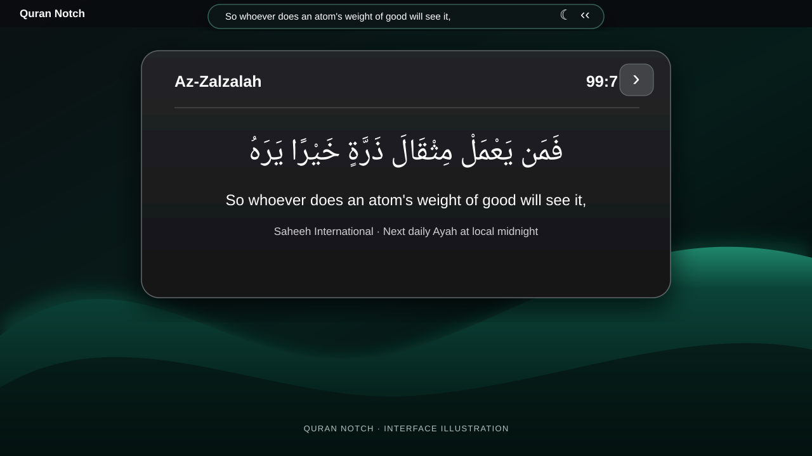

# Quran Notch

**A moment of Quranic reflection, right in your menu bar.**

A minimal Quran companion for macOS, with Arabic ayat and their English translation — designed for quiet reflection throughout the day.

[Installation](docs/INSTALL.md) · [Releases](https://github.com/shehryhere/Quran-Notch/releases) · [Changelog](CHANGELOG.md)

Interface illustration based on the running app. Real screenshots are being prepared for publication.

## A little reflection, every day

Quran Notch places a daily Quranic verse in a slim macOS menu-bar display. Open its panel for Arabic text, an English translation, the surah name, and verse reference.

### Features

- **Quran at a glance** — a discreet English verse in the menu bar.
- **Arabic and translation** — expanded reading panel with Saheeh International English translation.
- **Daily ayah** — designed to refresh on the user's local calendar day.
- **Minimal macOS experience** — dark interface with quick access and a lightweight menu-bar presence.

## Installation

**Status:** The original macOS application bundle has been supplied for release preparation, but a downloadable DMG has not yet been published.

When a release asset is available:

1. Open the [Releases page](https://github.com/shehryhere/Quran-Notch/releases).
2. Download the official `Quran-Notch-v1.0.0.dmg`.
3. Open the DMG and drag **Quran Notch.app** into **Applications**.
4. Open Quran Notch from Applications and use its menu-bar interface.

For Gatekeeper prompts and troubleshooting, read the [installation guide](docs/INSTALL.md).

## Requirements

- **macOS 13.0 or later**, per the supplied v1.0.0 app bundle metadata.
- **Apple Silicon (ARM64)** Mac, as identified from the supplied executable. Intel Macs are not supported by the provided build.

## About

| | |
| --- | --- |
| App | Quran Notch |
| Version | 1.0.0 |
| Developer | Shehryar Bin Habib ([@shehryhere](https://github.com/shehryhere)) |
| English translation | Saheeh International |
| Platform | macOS |

## Source and license

The supplied application is a compiled `.app` bundle; the original Swift source has **not** been published in this repository. No open-source license is currently granted. The repository may be publicly visible without being open source.

## Credits

English Quran translation: **Saheeh International**. Any distribution of Quran or translation datasets should comply with the applicable terms and attribution requirements.

---

© 2026 Shehryar Bin Habib. All rights reserved.

